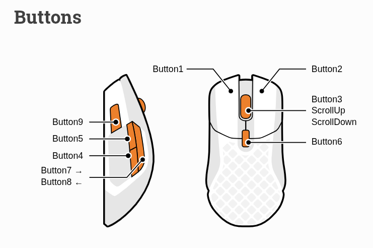

# Linux Configurations

Personal Linux mouse shortcuts, a hold-to-show performance overlay, Bluetooth status monitoring, and setup/recovery scripts.

This repository saves the working configuration for a SteelSeries Aerox 5 Wireless on an X11 Linux desktop. It is a personal configuration snapshot, not a universal installer: account paths, desktop shortcuts, Bluetooth device addresses, application IDs, and hardware labels need adjustment on another machine.

## Mouse button reference



The diagram identifies the physical buttons. These numbers differ from Linux/X11 button numbers and from the keyboard codes programmed into the mouse.

| Physical button or gesture | Current action |
| --- | --- |
| Button 1 | Left-click |
| Button 2 | Used by the gestures below; ordinary right-click menus are disabled on Aerox pointers |
| Button 3 | Wheel click; scroll remains available |
| Button 4: tap | Enable the laptop keyboard and keyd virtual keyboard |
| Button 4: double-tap | Toggle Activities |
| Button 5: tap | Disable the laptop keyboard and keyd virtual keyboard |
| Button 5: double-tap | Switch to the previous window |
| Hold Button 5 | Show the performance/Bluetooth overlay after about 0.2 seconds; release hides it |
| Hold Button 5 + left-click outside overlay | Open the centered app dock; subsequent left-clicks cycle apps; release Button 5 to launch the selection |
| Hold Button 5 + double right-click | Toggle Activities |
| Hold Button 5 + right-click while dock is open | Select an app tile or cancel by clicking outside the dock |
| Hold Button 5 + left-click inside overlay | Suppress the dock gesture; Bluetooth controls remain usable |
| Click Bluetooth heading while holding Button 5 | Open Bluetooth Settings |
| Click a device name while holding Button 5 | Open that device in Bluetooth Settings |
| Click a device's connected/disconnected text while holding Button 5 | Connect/disconnect that device by its Bluetooth address |
| Button 6 | Mouse sensitivity/CPI control |
| Button 7 | Print Screen |
| Button 8 | Disabled; no Button 8 event was detected in the tests on this mouse |
| Button 9: tap | Enter |
| Button 9: double-tap | Print Screen |
| Hold Button 9 + Button 1 | Minimize the window under the pointer, including an inactive window |
| Hold Button 9 + Button 2, then release Button 9 | Ctrl+Shift+T: reopen a closed tab in the active browser |
| Hold Button 9 + Button 3 (wheel-click), then release Button 9 | Close application windows one at a time, including minimized windows; stop when a window remains open for confirmation |
| Hold Button 1 + tap Button 2 | Alt+Tab |
| Double left/right-click without a held modifier button | Switch workspace left/right |

Button 9's reopen-tab action waits until release because the F3 binding in xbindkeys captures the keyboard while held. It sends the shortcut after an additional 0.1 seconds. The wheel-click gesture also runs after release: it snapshots normal application windows and sends WM_DELETE_WINDOW close requests. Each window receives one close request. The handler waits up to two seconds for it to disappear before advancing. If it stays open, the sequence stops so a browser Leave site or save prompt can be answered; use the gesture again afterward to close remaining windows. The handler never answers prompts or force-kills processes. It excludes existing dialogs, desktop panels, and the overlay. Background services are not terminated.

The tested mouse profile uses Button 4 = F16, Button 5 = F17, Button 7 = F18, Button 8 = disabled, and Button 9 = F3. The event handler also accepts native BTN_SIDE/BTN_EXTRA for Buttons 4/5. Firmware mappings can differ across connection modes; verify the events before changing shortcuts.

## Performance overlay

Hold Button 5 to display the overlay. The current order is:

1. RAM used/total, with a usage bar.
2. Storage used/total, with a usage bar.
3. CPU percentage and temperature, without a bar.
4. GPU load percentage and temperature, without a bar.
5. Bluetooth devices and their connection status.

GPU memory was deliberately removed from the final layout. GPU readings use one `nvidia-smi` query per second while the overlay is visible. Unsupported readings display `unavailable` instead of a fabricated zero. CPU temperature discovery uses the `coretemp` sensor.

Bluetooth display refresh runs every 0.25 seconds. Actual visible latency also includes rendering and Bluetooth's response time. Failed attempts show `failed` for four seconds before returning to the device's connected/disconnected state. All paired devices are listed separately by their actual aliases and addresses.

The GPU rows change the overlay's height. Its Bluetooth click map is separate from the main Conky map. If you change fonts or add/remove rows, update `CONKY_BT_ROW_START` in `overlay.conf` and the fallback heading position in `mouseenter`, then check the hit regions on screen.

## Files

| Location | Purpose |
| --- | --- |
| `bin/mouseenter` | Mouse event handler and gestures |
| `bin/reset-mouse-controls` | Restart the handler and check for duplicate processes |
| `bin/mouse_watchdog.sh` | Original Aerox USB/dongle firmware mapping helper |
| `config/autostart/mouseenter.desktop` | Start the handler at desktop login |
| `config/xbindkeysrc` | F3 suppression used by the mouse configuration |
| `config/conky/` | Overlay, Bluetooth state/rendering, GPU readings and navigation |
| `share/mouse-pinned-launcher/` | Centered app dock and X11 click capture |
| `system/bluetooth-startup/` | Administrator-installed automatic Bluetooth monitor and removal script |

## Requirements and portability

The mouse handler requires Python 3 with `evdev`, access to the mouse input devices, and optionally `/dev/uinput`. The interface requires X11, Xlib, GTK 3/PyGObject, Conky with Lua/Cairo support, `xdotool`, `xinput`, `wmctrl`, `xprop`, and `xwininfo`. Bluetooth uses BlueZ, `bluetoothctl`, `gdbus`, systemd, UPower, and Pillow for text-width measurement. Firmware mapping uses `rivalcfg` over USB or the 2.4 GHz dongle. NVIDIA GPU readings require an installed NVIDIA driver and `nvidia-smi`.

Activities behavior and workspace shortcuts are desktop-specific. Bluetooth navigation currently uses GNOME Settings, with an environment override for the original Cinnamon session. The dock uses a configured list of application desktop IDs; edit `launcher.py` for your installed apps. Wayland is not supported by the current X11 capture implementation.

Before restoring on another machine:

- Replace `/home/lonzo` paths with your account path.
- Update the account UID/GID in `system/bluetooth-startup/conky-bt-supervisor.py` and the service's writable cache path.
- Update keyboard device names and hardware labels; do not assume another laptop exposes the same sensors or input devices.
- Review Bluetooth addresses in the optional AirPods/mouse helpers. Device aliases in the overlay itself come from live BlueZ state.
- Optional AirPods battery helpers call `~/bin/airpods`, which is an external dependency not included here. Without it, those readings need a replacement battery reader.
- Match the mouse firmware profile to the handler's F-key mappings. `rivalcfg` button updates can reset omitted button mappings, so supply the complete intended mapping.

## Restore user files

Back up your current files first. These commands describe the original account's layout; customize the source scripts before using them on a different account.

```bash
mkdir -p ~/bin ~/.config/conky ~/.config/autostart ~/.local/share/mouse-pinned-launcher
cp bin/mouseenter bin/reset-mouse-controls bin/mouse_watchdog.sh ~/bin/
cp config/conky/* ~/.config/conky/
cp share/mouse-pinned-launcher/* ~/.local/share/mouse-pinned-launcher/
cp config/autostart/mouseenter.desktop ~/.config/autostart/
cp config/xbindkeysrc ~/.xbindkeysrc
chmod +x ~/bin/mouseenter ~/bin/reset-mouse-controls ~/bin/mouse_watchdog.sh ~/.config/conky/*.sh
```

Install dependencies and grant the required input-device permissions using your distribution's normal administration tools. Do not make input devices world-writable. Restart xbindkeys to pick up its configuration, then use `~/bin/reset-mouse-controls` to restart the mouse handler. Avoid starting additional copies manually; the handler also uses a lock to prevent duplicate actions.

## Automatic Bluetooth status at boot

A regular user cannot monitor other applications' BlueZ connection requests on the original machine. This setup runs a narrowly filtered `dbus-monitor` as root and drops privileges to the ordinary user for the parser and overlay updates.

After reviewing/customizing the files, run:

```bash
bash system/bluetooth-startup/install.sh
```

Enter your administrator password in Terminal only. The installer creates root-owned files in `/usr/local/libexec` and `/etc/systemd/system`, enables the service at boot, and restarts it. It does not change sudoers, grant an AI agent administrator access, or relax the system D-Bus policy. The parser has no effective, permitted, or ambient capabilities after the privilege drop.

Verify:

```bash
systemctl status conky-bluetooth-status.service
journalctl -u conky-bluetooth-status.service -n 30 --no-pager
```

The service remains available after login or resume and restarts if its monitor/parser exits. No open Terminal or chat is required.

Remove the automatic monitor with:

```bash
bash system/bluetooth-startup/uninstall.sh
```

## Troubleshooting

- **Ordinary clicks trigger shortcuts:** release the held buttons, run `~/bin/reset-mouse-controls`, and confirm there is one handler. Check the actual mouse press/release events before remapping a button.
- **Reopen closed tab does nothing:** activate the browser, hold Button 9, right-click, then release Button 9. This restores a closed tab; it does not restore a minimized window.
- **Right-click menus return after reconnect:** confirm the handler is running. It disables native right-clicks for all Aerox X11 pointer devices while continuing to read raw events for gestures.
- **Overlay click opens the dock or targets the wrong row:** check the overlay-specific `/tmp/conky_bt_layout.overlay.tsv`, its starting offset, and the current font/layout.
- **Settings connection attempts do not show connecting:** verify `conky-bluetooth-status.service` is active, not stuck in an auto-restart loop.
- **Bluetooth battery unavailable:** disconnected devices do not provide a guaranteed current battery reading. GPU/battery support varies by device; stored readings are not evidence of a live connection.

Useful local logs: `~/.cache/mouse-keyboard-actions.log`, `~/.cache/mouseenter.log`, `~/.cache/conky_bt_toggle.log`, and `~/.cache/conky_bt_navigation.log`. Runtime logs and battery caches are not part of this repository.
